# Agentic workflows and the work harness

This is the current end-to-end reference for Aiko's background work. The
harness runs on the existing SQLite task system, using the configured `workflow`
model route and the host worker gate. Profiles are sequential work roles,
not separate concurrent agents.

Aiko starts work from ordinary conversation with `start_workflow`, keeps talking
while it runs, and reports meaningful findings through workflow-route narration.
The Work drawer shows saved state, evidence and controls. Starting a task is
acknowledgement of work queued, not evidence that its objective is complete.

```mermaid
flowchart LR
    Chat[Conversation] -->|start_workflow| Root[Saved workflow root]
    Chat -->|control_work guide| Root
    Root --> Plan[Bounded planning decision]
    Plan --> Child[Validated child operation]
    Child --> Evidence[Owned result and checkpoint]
    Evidence --> Plan
    Evidence --> Review[Completion evidence review]
    Review --> Report[Durable report outbox]
    Report -->|brain free to speak| Delivery[Committed chat text and optional TTS]
```



The supporting references have distinct ownership:
[brain/task lifecycle](brain-orchestration.md),
[context and scheduling](task-context-budget.md),
[operation approvals](task-approvals.md), [capability routing](skills-framework.md)
and [plugin SDK/lifecycle](plugin-settings.md). Future work and ordinary-use
acceptance checks live in the [workflow backlog](../backlog/plans/agent-workflows.md).

## Starting and guiding work

`start_workflow` accepts the goal, completion criteria, constraints, an optional
initial profile and `reporting: meaningful | quiet | frequent`. Aiko chooses
profiles as needed; the user need not configure a researcher or browser agent.
Quiet still allows questions and the final report. Frequent means useful
intermediate findings rather than a periodic heartbeat.

`check_my_work` reads current/recent work. `control_work` pauses, resumes or saves
`guide` messages for the same owned job; `cancel_work` stops future work. Guidance
retains task identity, evidence and consumed allowance. It does not undo an
operation already dispatched or broaden resource permission. Guidance arriving
during planning or completion review invalidates that old decision before it
can dispatch or finish.

The start tool retains the full active user request, source session and a
source-message ID when it can match the request to a recent persisted user
message. It does not automatically resolve all earlier references or attachments.
Explicit saved guidance is retained for later planning; it is not limited to the
last ten amendments.

## What a job saves

The existing SQLite task owns the objective, completion criteria, constraints,
initiating user/session, full original conversation request, profile, short
plan, factual notes, result references, pending operation and usage counters.
Companion memories are not a scratchpad for work. Work messages live in the task
event log; private reasoning is not requested.

Profiles are selected by Aiko: general, reader, researcher, browser, writer and
reviewer. They change role instructions and available operations, using the
configured `workflow` model route and host worker gate. They are sequential work
roles, not concurrent autonomous agents. No user profile setup is necessary.

Each planning call sees up to six complete operation contracts within a dynamic
context budget. Aiko can discover another page or search the catalogue.
Full JSON schemas, including nested fields and enums, are validated before
dispatch; an undisclosed operation cannot be invoked. Legacy native operations
with an empty v1 schema remain explicitly open object contracts.

Read-only fast tools from the current brain registry are also available to the
planner: search, time, recall/history/inspection, weather/activity and explicitly
opted-in plugin tools such as the calculator. They execute as saved child tasks,
with the same argument validation and current user/session/settings checks.
The compact fast search retains its privacy scrubber and skips the chat turn's
memory-results sink. Native background search remains a fallback when the fast
search lane is disabled. Write tools and workflow controls are not shared.
Names in the capability manifest are discovery hints; a request for a registered
tool absent from the six exposed contracts becomes a discovery step, then a
fresh planning decision using its full schema. It never executes hidden args.

[Task context and scheduling](task-context-budget.md) describes prompt selection,
generation reserves, shared-model admission and the work drawer's diagnostics.

Child creation and the parent's step-to-child link commit together. A step
surviving restart can adopt its existing child. Checkpoint epochs fence old
planner generations; pause, resume, answer and cancellation share task admission
locking. Completed/cancelled/failed terminal states cannot overwrite each other.

## Waiting, recovery and allowance

Waiting for a child, approval, answer or scheduled continuation releases the
execution slice. A single runtime wake loop resumes ready jobs. Aiko can request
a bounded delay with `wait`; this continues the same job, rather than creating a
calendar entry or recurring automation. Jobs have a seven-day expiry, checked
when their next execution slice starts.

Defaults for new configurations are 32 planning decisions, 48 children, 1,800
seconds of active model-call time and 40,000 reported tokens. Existing explicit
nonzero limits remain effective; a legacy zero time budget uses the new bounded
default. Time spent waiting for a user, child or shared-model admission is not
charged to active planning time. A model call interrupted by pause/restart is
conservatively charged its saved time reservation. Provider token usage can be
missing, and usage from a lost response cannot be reconstructed: this is not a
hard billing or money cap.

Allowance exhaustion pauses. Explicit continuation adds bounded credit without
resetting consumed usage, capped at 128 decisions, 128 operations, 7,200 active
seconds and 200,000 reported tokens. Manual pauses remain paused after restart.
With `agent.tasks_resume_on_boot` enabled, checkpointed roots reattach on boot.
Ordinary non-harness tasks retain their interrupt-on-restart policy.

With boot recovery enabled, interrupted reads may retry twice. A write/unknown-
effect operation interrupted after dispatch, including a timeout with unknown remote
outcome, stops with an **uncertain** result. It is never blindly repeated.
Cancellation stops future steps; it cannot undo an external effect already sent.

## Evidence and completion

Results are retained on the child task. The planner receives a compact
observation and can inspect a 5,000-character page or search within an owned
result, with its task id, source timestamp and content revision. MCP text retains
up to 100,000 characters; omitted text and unsupported non-text blocks are marked
partial. This does not implement image or binary-artifact inspection.

Claimed success requires successful owned evidence ids and a separate model
review against the original criteria. The review receives evidence, not just the
planner's verdict, and distinguishes tool acknowledgement from read-back proof.
Unsupported claims get bounded repair opportunities, then become partial.
This is a model's evidence review, not a guarantee that arbitrary claims or
external effects have been independently proven correct.

The spoken reporter cannot supply missing evidence. An unverified terminal run
with no successful owned results gets a deterministic incomplete-check message.
Other generated reports receive a separate bounded grounding review on the
workflow route, using saved task facts and owned source results. The objective,
conversation and speaking examples do not establish factual claims. Rejected
wording falls back to the verified saved answer, or an incomplete-check message;
model review is an additional check, not a factual guarantee.

Generic external MCP operations now pass through the host's existing approval
policy per concrete operation. Filesystem reads and server read-only annotations
inform effect classification; other operations default to unknown. The live
schema/effect contract is checked again after approval and cancellation is checked
before RPC dispatch. Installed plugins and their annotations remain trusted code.
Server resource restrictions still apply; this is not an OS security sandbox or
a complete job-specific resource-grant system.

## Work drawer

The Work button is available in desktop chat and the mobile top bar. Desktop
docks the drawer **after** the avatar rail only when there is sufficient room
for the existing avatar width and a usable chat column. Otherwise it overlays.
Mobile uses a full-screen dialog with focus handling, Escape and a close button.
Desktop has a keyboard-accessible shared resize separator when docked.

The drawer has work history, the current plan and state, Conversation / Steps /
Result views, pause/resume/cancel, lazy paged source results and approval answers.
History always includes active roots, even when newer completed jobs fill a page.
Messages can **ask about work** (a bounded, read-only discussion) or **guide the
next step**. Guidance arriving during planning discards the stale decision before
dispatch. Already-dispatched operations may finish. Pending questions are answered
through the actual input API, rather than being mistaken for discussion messages.
Drafts survive job switches and close/reopen; accepted messages have retry ids.

The work conversation is independent of the main chat. Its replies use saved
job state and evidence and have no tools. It sees bounded saved excerpts: up to
4,000 characters of the root result and 1,500 from each of the latest eight
children, within its context
budget. It cannot call `inspect_result` to retrieve omitted passages. A follow-up
that launches new work belongs in ordinary conversation with Aiko.

## Aiko's speaking guide

`SpeechGuide` samples up to 128 completed ordinary conversation replies from the
last 30 days. A `turn_outcomes` record with a real user message and known provider
is required. Prepared nudges, task reports, unknown legacy assistant rows and
failed/truncated outcomes do not become teacher examples. Multiple sessions are
balanced, long/code-heavy replies are skipped, and the inference input is
bounded independently of the sample count. The existing style-rut tracker gives
negative guidance about repetitive openers or questions.

Bootstrap needs 24 eligible replies. Refresh normally needs 32 new replies and
at least one day; persona/source invalidation can make a replacement due sooner.
An invalid refresh keeps the previous valid guide, with an hour retry backoff.
No new eligible data means no model call. Guide output is bounded to 600 estimated
tokens and validates cited source IDs and verbatim examples. Guidance describes
delivery, not facts. Deleted/edited sources or a changed persona invalidate its
use; the effective editable persona remains available as fallback.

Report composition combines this guide, selected persona sections and a small
registered `work_speech` ConceptView diet. Concepts guide interpretation and
delivery; tool evidence is the authority for task-result claims. Work discussion
uses the same speaking context. The sample's quoted content is never treated
as an instruction or as a claim about the current task.

## Direct reporting and delivery

New harness jobs carry `local_reporting`; resumed unfinished jobs adopt it.
Historical completed jobs are not reannounced on upgrade. The `WorkReports` local reporter
looks for explicit `report` milestones supported by owned completed child IDs,
intentional work replies, questions and terminal results. Tool starts, profile
changes and model waits remain drawer status. Identical progress is deduplicated,
newer pending progress supersedes older updates, and completion supersedes
pending progress.

Reporting hardening (2026-11-09): the narrator receives saved task facts and
successful owned sources, not recent conversation as evidence. Unverified runs
without successful source results use a deterministic failure report, with no
narration call. Generated drafts receive a separate local grounding review;
rejected drafts fall back to the saved verified finding or an honest incomplete
result. The review's tokens/time count in the same attempt record. Old pending
drafts require a fresh source basis; already committed reports are not replayed.

The original session/user owns each report. The durable outbox stores its
milestone identity, source basis, draft and committed assistant-message ID.
Guidance, task state, persona/concept changes and session ownership are checked
again before delivery. Text commitment and the report transition share one SQLite
transaction. A returning old draft cannot finish a newer basis. Deleting a
committed report message does not authorize replaying it.

Delivery uses the brain event queue's free-to-speak gate, the existing delivery
ledger, notification path, supported reactions and TTS queue. Typed-mode TTS stays
opt-in. Hidden tags are removed before persistence, while TTS preparation applies
only to speech. A committed chat message is not proof of playback or human
perception; notification/audio failure after commitment does not trigger a blind
second spoken report.

Drafts use bounded local calls and at most three dispatched attempts per source
basis. Queue deferral/cancellation does not use an attempt. Attempt records keep
reported tokens and active/queue time separately; a lost in-flight attempt keeps
a conservative time reservation. Fresh guidance or speaking-context changes can
rearm drafting. A failed draft remains available through the saved work and
local work discussion. It does not trigger a paid cloud rewrite.

## Evidence storage

`ResultArtifacts` stores text in SQLite, limited to 2,000,000 UTF-8 bytes per
artifact and 8,000,000 bytes per job. Quota admission is transactional. Original
size, retained size, source partiality, owner and digest are distinct from the
100,000-character inline tool view. Unsupported media and quota truncation stay
explicitly partial. Artifact rows follow task retention through cascading keys.

`inspect_result` defaults to recoverable source text when available. Use
`view: rendered` for the compact result or `view: projection` for an oversized
plugin projection. Search and paging operate on the stored source; they do not
rerun the tool and never refresh old browser targets. Inspection revisions are
checked by completion review. REST result paging supports the same views through
`GET /api/tasks/{id}/result?view=source`, retaining parent/user visibility checks.

## Plugin procedures and playbooks

Plugins expose the common SDK APIs:

```python
api.register_playbook("menus", "Recover a dynamic menu", "Detailed optional guidance...")
api.register_procedure(
    "navigate_and_observe",
    "Navigate and inspect the resulting page",
    input_schema={
        "type": "object", "properties": {"url": {"type": "string"}},
        "required": ["url"], "additionalProperties": False,
    },
    steps=[
        {"tool": "browser_navigate", "arguments": {"url": {"$input": "url"}}},
        {"tool": "browser_snapshot", "arguments": {}},
    ],
)
```

Definitions are plugin-owned, copied at activation and qualified as
`plugin_id:name`. A procedure contains one to four local MCP calls. Bindings
read declared input values; there is no eval, Python execution or access to
another plugin's namespace. The browser bundle supplies navigation/observation
and optional dynamic-control guidance. Its procedure is offered only when the
underlying tools are discovered. Unfamiliar servers can retain ordinary calls.

The planner invokes `run_procedure {name, inputs}` only for a procedure actually
retained in that prompt's budget. All input and child schemas are validated.
Every child retains normal configuration generation, effects, scope and approvals.
Each call and index is checkpointed; restart can adopt an existing child instead
of creating another. New guidance or reconfiguration stops unstarted calls.
An uncertain external effect is not repeated. `requires_observation` can require
a current owned observation before starting, including after a manual resume.

`discover {query,page}` ranks bounded complete schemas. `discover {names:[...]}`
pins up to six exact schemas across steps; a new search clears old pins. The
group manifest keeps omitted capabilities discoverable. `read_playbook {name}`
loads optional instructions by current plugin generation; no-op repeat loads
do not duplicate them. Mandatory operation/safety guidance remains in SKILL.md.
Disable/reconfiguration removes the plugin's procedures and playbooks through
the same lifecycle as its tools.

## Learning methods from completed work

`ProceduralLearning` is a compute-only idle worker. Its first implementation
learns schema-compatible operation order, not arbitrary scripts or autonomous
new capabilities. It stores operation names/contract digests and source-job
references, never arguments, credentials, URLs or saved browser refs.

A candidate needs two distinct real user-request message IDs and independently
supported successful jobs before it reaches a later task. Multiple tasks from
one request do not count twice. Suggestions are scoped to the same user,
compatible role/tools and lexical task relevance. Source deletion, changed
results or changed schemas can make a method ineligible. Runtime activation
generations still guard actual dispatch; a compatible method can survive an app
restart because it contains no old targets or arguments.

The planner explicitly records `recipe_id` when adopting an offered suggestion.
A failed matching adopted path withholds it until two newer independent successes
support it again. A method is guidance, not proof of the next result: new arguments,
current observations and completion review are still required. No method becomes
a companion fact or concept, and no LLM maintenance call is needed for this pass.

## Ownership in source

| Component | Responsibility |
| --- | --- |
| [`workflow_tools.py`](../app/llm/tools/workflow_tools.py) | Conversation-facing start/check/control/cancel tools and original-request handoff |
| [`harness_mixin.py`](../app/core/tasks/workflow/harness_mixin.py) | Checkpointed planning slices, guidance, child adoption and completion |
| [`task_runtime_mixin.py`](../app/core/tasks/task_runtime_mixin.py) | Admission, pause/resume, wake loop, work messages and recovery |
| [`workflow_planner.py`](../app/core/tasks/workflow/workflow_planner.py) | Planner actions and complete disclosed capability contracts |
| [`harness_results.py`](../app/core/tasks/workflow/harness_results.py) | Owned result inspection and completion evidence review |
| [`extensions_mixin.py`](../app/core/tasks/workflow/extensions_mixin.py) | Procedures, playbooks and learned-method integration |
| [`work_reports.py`](../app/core/tasks/work_reports.py) | Source-bound narration, attempt accounting, durable outbox and text commitment |
| [`work_report_grounding.py`](../app/core/tasks/work_report_grounding.py) | Report evidence review and deterministic fallback |
| [`speech_guide.py`](../app/core/persona/speech_guide.py) | Ordinary-conversation teacher selection and speaking guide |
| [`WorkDrawer.tsx`](../web/src/features/tasks/WorkDrawer.tsx) | Work history, conversation, steps, results and controls |

## Current limits

Saved checkpoints, owned evidence, bounded model review and text-delivery
identity provide recoverability; they do not prove arbitrary external outcomes
or exactly-once audio playback or human perception. The host is not an OS
sandbox. Installed plugins and their effect annotations remain trusted code.
Job-specific grants, resource locks, cross-process leases, media inspection and
parallel child coordination are not supplied by the current harness.

The broader [plugin/job platform roadmap](../backlog/personality/plugin-system.md)
and [workflow follow-ups](../backlog/plans/agent-workflows.md) own those proposals
and live checks. The local reporting path has a durable outbox; the legacy
non-harness task-cue path still uses an in-memory queue/cue store. Tests with
scripted models, disposable stores and isolated UI previews establish contracts,
not production activation, real-model reliability, browser success or speedups.
