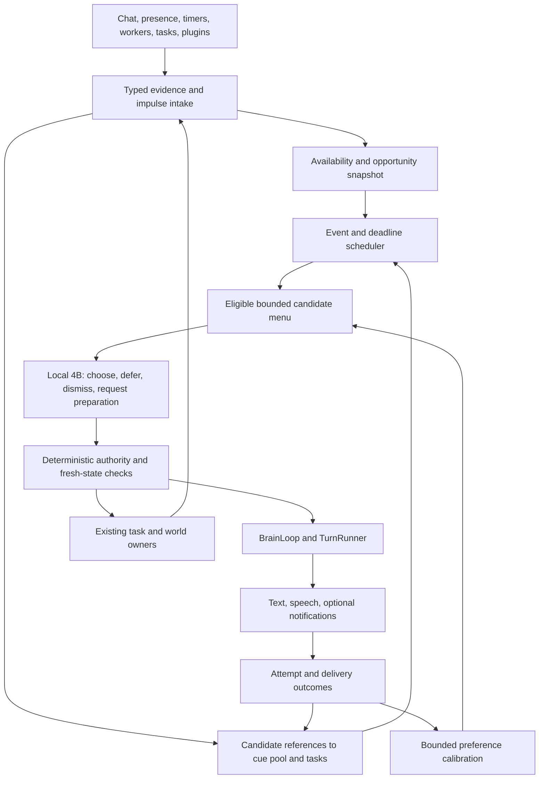

# Historical Live initiative architecture review

28-30 Sep 2026 source/installation snapshots and target contracts. These counts are not current measurements. [Active queue](../live-initiative.md).

## Recommendation

Keep `BrainLoop`, `TurnRunner`, the cue pool, concept/memory stores, tasks,
and the Live impulse/embodiment layers. Rework the middle:

**evidence -> durable candidate -> suitable opportunity -> small-model
decision -> authorized brain/task action -> delivery/result -> learning.**

The current system is much better equipped to react quietly than to originate
and carry through a thought. More gesture enums, a larger policy prompt, or
lowering every speech gate will not fix that lifecycle. Restore an observable
end-to-end path first, then expand what can originate a candidate.

The product target is a companion with ongoing interests, occasional
conversation, useful follow-through, and independent background activity.
Independence means she can choose and complete permitted work without another
chat turn; it does not mean inventing experiences, ignoring consent, or
requiring the user to keep responding. The small model decides among bounded
next actions. The main brain gives a thought its voice and reasons about work
that exceeds the policy model's remit.

## Evidence and limits

### Field review: 30 Sep 2026

**Read-only runtime review; no settings or behavior changes.** Retained
`data/app.log` plus `.1` through `.5` span 27 Sep 01:24:31 through
30 Sep 15:40:36 in local log time (UTC+02:00). This review selects
28 Sep 00:00:00 through 30 Sep 15:40:36, not 48 measured hours of Live use.
The first policy result in that window is at 28 Sep 17:43:26. Logs can span
restarts and periods outside Live; retention coverage is not continuous
availability. The main MCP snapshot was sampled at 30 Sep 13:40:32 UTC;
worker and C6 snapshots and read-only SQLite queries followed separately.
Only aggregate software evidence is recorded here, without conversation
text, cue subjects, titles, device addresses or personal interpretations.

**Rollout boundary.** The five phase/pilot commits above landed on 28 Sep
between 21:07 and 21:44 local time. Of the results below, 252 occur after
the final commit; all remain nonverbal. Commit time is not deployment time:
the running import/build revision is unverified. In particular, the runtime's
last prompt-region report lacks `transcript`, which the checkout emits even
when empty. This repeats the earlier diagnostic mismatch; it does not prove
that any particular prompt or phase was loaded. Do not call this a clean
before/after trial of all five commits.

| Observation | Measured result | What it establishes |
| --- | --- | --- |
| Retained policy funnel | 384 `live consider` and 384 canonical policy-result lines: 214 `attend`, 146 `acknowledge_user`, 23 successful `remain_present`, one `remain_present` rejected as `unknown_urge` | Zero recorded `request_main_speech`, `wait` or `noop` results. The main-speech deficit is upstream of delivery in this recorded path. |
| Trigger mix | 207 activity-session changes, 85 user messages, 28 idle reconsiderations, 21 sleep changes, 20 activity-idle events, 12 session changes, eight silence wakes, three shared-commitment changes | Most decisions are reactive; total calls are not autonomous opportunities. |
| Speech constraints | 193 decisions with `rare`, 168 with `normal`, 23 with `forbidden` | Restrictions matter, but cannot alone explain the absence of speech proposals. A normal budget is not proof of candidate eligibility or interruptibility. |
| Autonomous candidate wake | All 28 `idle.reconsider` results are on 30 Sep with `normal` budget: 13 attend, 13 acknowledge, two remain-present | The new wake path is observable; waking alone did not produce substantive proposals. No candidate-level history proves which choices were available to each call. |
| Policy elapsed time | Median 1,554 ms, nearest-rank p95 2,759 ms, maximum 11,129 ms, across 384 results | No evidence here that a wholesale policy timeout explains silence. This is reported policy elapsed time, not end-to-end speech latency. |
| Current-process counters | 80 nonverbal executions; zero main-wake proposals, admissions, rejections, silence outcomes and proactive enqueues; zero recorded policy failures | This is not a two-day counter. `main_wake_proposed` increments after arbitration; the separate log scan is what checks pre-execution speech proposals. |
| Candidate/source mismatch | Retained urge tail: 12 expired records, 11 cue-backed, all with `opportunity_seen=false`; no wait, main-wake token available. Later SQLite lookup: eight of those source cues still pending, unexpired and never surfaced; three already used | A durable cue can outlive its transient Live attempt. Current state is not a reconstruction of every historical opening; `opportunity_seen=false` also does not prove no model ever saw the cue. |
| Candidate composition | Nine of the 11 retained pooled urges refer to curiosity seeds, two to knowledge-gap notices; all are `ask_about_result` | The sampled menu supply is narrow and question-shaped, not evidence of a diverse share/continue inventory. This tail is not the full trial's candidate distribution. |
| C6 supply/freshness | One C6 draft log and one SQLite C6 row created in the window; two `companion_activity_block` inclusions, no Live handoff. At inspection all five returned historical C6 rows are expired; latest interpretation computed 28 Sep 22:47:07 UTC, about 39 hours old | C6 did supply ordinary-turn context, but not a sustained fresh Live source in this sample. Surfaced/inserted is not spoken or heard. |
| C6 worker health | Enabled and registered; companion/activity-interpretation workers each report 551 process-local runs, zero errors and latest admission `idle` with zero pressure | Repeated worker invocations do not mean new observations or drafted cues. Current frame independently marks `c6` and `os_idle` stale. |
| Connectivity | 30 connects, 30 disconnects, 51 owner-election lines; 11 disconnects leave zero clients. Latest preceding client-count record is zero for 12 idle reconsiderations and positive for 16 | Disconnection is relevant, but not sufficient to explain all 28 choices. These are log correlations, not synchronized availability snapshots or identified mobile/desktop cohorts. |

**Confirmed mechanisms versus hypotheses.** The current
[urge store](../../../app/core/live/urge_store.py) keeps a source-evidence block
after attempt expiry; its one deferred rescue is opening-dependent and
bounded to 15 minutes. The one-shot wake does not establish durable decline,
defer or retry ownership. The source-row mismatch makes **L21/L22 the
strongest implementation follow-up**, without promising every pending cue a
spoken turn. The adapter also pages eight rows before eligibility filtering,
so the next review must trace selection omissions rather than infer them
from a global pending count.

The [compact situation renderer](../../../app/core/live/prompt.py) shows
commitment and recent event names but does not explicitly render the current
trigger, user-intent age, source staleness or the turn/typing/floor fields.
The retained impulse tail can include old user events without their age.
**Hypothesis:** an idle candidate decision is being treated like continued
acknowledgement of the last user interaction. The 13 idle acknowledgements
make this worth a discriminating replay, but missing historical menus and an
unverified deployed prompt prevent a causal verdict. More tokens or a
stronger model alone are not an evidence-backed fix.

C6's [producer](../../../app/core/activity/companion_cue_worker.py) deduplicates
by activity kind plus app, not by episode or cue expiry. A repeated signature
does not redraft. That is a useful anti-repetition rule, but not a complete
renewal policy for a later genuinely new episode. The old interpretation and
expired stock do **not** justify periodically recycling stale desktop facts,
especially when the active client provides no desktop activity feed.

#### Ranked follow-up from this trial

| Order / existing owner | Bounded next change | Discriminating acceptance check |
| --- | --- | --- |
| 1. [L19](../live-initiative.md#l19-explain-silence-across-the-entire-funnel) + [L30](../live-initiative.md#l30-replay-and-rollout-are-part-of-the-architecture) | Add process/build and prompt-schema identity; persist content-free opportunity, candidate/menu, trigger, gate and result IDs. Record actual menu inclusion and completed evaluation separately from wake scheduling. Use server-owned reason enums; model-generated reason strings are not safe categorical telemetry. Clarify that `live_policy_loaded` reflects `warm()`/`unload()`, not inference success. | Read-only report explains an empty menu, expired attempt, legitimate defer, worker failure and nonverbal choice separately across a restart. No dialogue/title/subject or raw reasoning is required. |
| 2. [L21](../live-initiative.md#l21-durable-intentions-short-lived-action-attempts) + [L22](../live-initiative.md#l22-event-and-deadline-scheduling-with-a-liveness-guarantee) | Keep unresolved source intent separate from a 45-second action attempt. Give each declined/deferred or never-evaluated candidate a bounded next event/deadline or terminal reason. Apply eligibility/fairness before the menu page; do not reset all TTLs on heartbeat. | A cue arriving during more than 45 seconds of typing remains resolvable at a later opening; a nonverbal decision cannot orphan it. Consumed/expired source rows never resurrect; no periodic inference storm. |
| 3. [L23](../live-initiative.md#l23-a-compact-4b-deliberator-with-useful-choices) | Explicitly render trigger, user-intent age, floor/turn state, candidate freshness and stale evidence. Offer distinct bounded share/continue/ask actions and a reasoned defer, while keeping a genuine fresh user message on the acknowledgement path. | Paired replay: identical grounded candidate with a fresh message versus a long quiet opening. Compare current and revised prompts with the real routed model; report speech/defer/nonverbal choices and false interruptions, not only valid JSON. Also test empty stock and forbidden speech. |
| 4. [L20](../live-initiative.md#l20-availability-is-not-window-focus) + [L29](../live-initiative.md#l29-desktop-and-mobile-delivery-are-different-capabilities) | Feed known reachability and capability freshness into candidate scheduling. Park speech-only opportunities while no recipient is reachable, retain a bounded reconnect wake, and revalidate at dispatch. Preserve the existing enqueue/dispatch guard. | Zero-client intervals do not spend speech-only policy calls; reconnect schedules at most one fresh reconsideration. Two devices do not duplicate delivery. Unknown reachability stays unknown, not confidently present. |
| 5. [L25](../live-initiative.md#l25-grounded-impulses-and-a-connected-curiosity-ledger) / C6 + [L27](../live-initiative.md#l27-an-extension-contract-for-producers-and-behaviors) | Diagnose source supply with observation age and explicit skip reasons. Preserve source purpose rather than defaulting everything to ask. Renew C6 only on fresh evidence of a new episode; add one verified completed-work result source after lifecycle/measurement works. | Same unchanged observation never regenerates a cue; a supported new episode can. Desktop-sensor absence on mobile does not become a current desktop assertion. Questions-disabled still admits a grounded share, never a disguised personal question. |
| 6. [L24](../live-initiative.md#l24-transactional-brain-handoff-and-honest-completion) before enabling more speech | Finish attempt-to-delivery settlement, including post-enqueue disconnect and main-generation failure. | Queue acceptance, generated text, presented text and confirmed playback have distinct outcomes; retry cannot double-speak. This trial has no main-wake delivery samples, so it cannot certify that path. |

**Next observation gate.** First verify the running revision and prompt schema,
then replay synthetic positive/negative cases without altering live history.
For the next opt-in field window, record available connected time and eligible
candidate opportunities, split by capability cohort and source. Every
unresolved candidate needs a next owner/deadline or an explicit terminal
reason; every speech attempt needs a delivery outcome or `unknown`. Compare
the 16 connected idle decisions only as this trial's bounded reference, not a
target rate. Do not raise cadence, disable privacy/quiet gates or add a speech
quota to make counters move. Richer context disclosure remains separately
permissioned design work, not a change made by this review.

### Running snapshot

A read-only `get_live_situation_frame` snapshot observed at
**2026-09-28 17:24:33 UTC** reported:

| Signal | Observation |
| --- | --- |
| Posture and permission | `live_presence`; quiet off; unprompted speech on |
| Runtime | Heartbeat running; policy loaded; no policy call in flight |
| Recorded executions | 74: 36 `attend`, 38 `acknowledge_user` |
| Main-wake execution counters | 0 proposed, 0 admitted, 0 rejected, 0 silent |
| Brain handoff | 0 proactive turns enqueued |
| Budgets | No exhausted classes; main-wake token available; configured ceiling 6/hour |
| Scheduling and candidates | No current wait; no active candidate urges |
| Retained urge tail | 12 expired rows; 11 cue rows with `opportunity_seen=true` |
| Last policy call | About 1.72 seconds; 1,901 reported input tokens |

These are process-local counters and a bounded tail, **not** a 12/12 lifetime
expiry rate, a measured eligible-hour rate, or proof every cue deserved speech.
The `main_wake_proposed` counter increments inside `_execute_main_wake`, after
initial arbitration: zero does not rule out a model speech proposal rejected
earlier. The executing process's source revision was not verified. In
particular, its last-call region report omitted the transcript region that
the checkout's prompt assembler now includes. Do not treat this snapshot as
an evaluation of every latest patch.

The supported conclusion is narrower and useful: this process recorded Live
activity without any main-wake reaching that execution stage. Investigate
candidate admission and scheduling before blaming TTS or increasing volume.
No private conversation, cue subjects, personal concepts, or activity titles
are needed in the backlog or future reproduction fixtures.

### Source findings

**Historical baseline from the initial 28 Sep review, before the phase commits
above.** In particular, Phase 1 supersedes the wait-only heartbeat and
premature opportunity-marking rows; Phase 3 supersedes false admission after
enqueue failure. Their broader lifecycle/delivery concerns remain open. The
dated field review above describes the newer observations, not a claim that
those fixed mechanisms are still present.

| Priority | Verified mechanism | Consequence and owner |
| --- | --- | --- |
| P0 | [Silence dispatch](../../../app/core/session/task_orchestration_mixin.py) publishes `silence.wake` and returns instead of calling the old director in Live posture. [Silence urges](../../../app/core/live/urge_store.py) are `remain_present`, not substantive speech candidates. | Silence alone supplies neither content nor a substantive candidate. Preserve that distinction, but supply a grounded continuation/share path: L22/L25. |
| P0 | [Heartbeat scheduling](../../../app/core/session/live_mode_mixin.py) promotes `idle.reconsider` only after an existing wait expires. [Controller](../../../app/core/live/controller.py) ignores `data_only`; non-wait actions need not leave a future wake. | An active heartbeat is not a liveness guarantee. With no wait and no new semantic event, policy can remain dormant: L19/L22. |
| P0 | [Inclination](../../../app/core/live/inclination.py) projects cues during frame updates and calls `note_opportunity` from a floor/admission predicate, including on a heartbeat. It does not require a completed model evaluation. | A cue can have a nominal opportunity without ever being considered. L17's missed-opening rescue then does not apply: L21. |
| P0 | [Urge store](../../../app/core/live/urge_store.py) gives cue asks/shares 45 seconds, does not renew on merge, and blocks identical evidence after expiry. L17 only defers cues with no recorded opportunity, once, within 15 minutes. | Durable subject lifetime and immediate action lifetime are coupled. A still-pending cue can disappear from Live without being declined or delivered: L21. |
| P1 | [Cue adapter](../../../app/core/live/cue_adapter.py) maps only a few types to share/continue; other known types default to ask. [Curiosity seeds](../../../app/core/proactive/curiosity_seed_worker.py) already distinguish person and subject interests; [associative cues](../../../app/core/proactive/cue_accounting.py) can be spoken shares. | Source intent is lost. Question-blocking can suppress material that did not require a question: L23/L25/L27. |
| P1 | [Live cue intake](../../../app/core/session/live_mode_mixin.py) reads eight rows. [Pending order](../../../app/core/proactive/cue_store.py) favors lowest surfaced count, then newest; adapter eligibility filtering occurs after this limit. | Blocked/repeated rows can occupy the page while useful candidates below it are invisible. L21/L23 need eligibility-aware fair selection, not a larger blind limit. |
| P1 | [Inclination](../../../app/core/live/inclination.py) schedules a wait when any budget class is exhausted. | An attention/expression limit can suppress unrelated inference opportunities. Separate action eligibility from inference scheduling: L22. |
| P1 | [Presence](../../../app/core/session/proactive_presence_mixin.py) uses window visibility for one gate and zero connected clients for `is_user_away`. [Live admission](../../../app/core/live/main_wake.py) has no unified recipient availability contract. | Focus, connection, capture, physical presence, interruptibility, and reachability are different facts: L20/L29. |
| P1 | [Voice controls](../../../app/web/ws_live_commands.py) publish `user.voice_start`; [assembler `_speech_active`](../../../app/core/live/assembler.py) returns active/listening for that retained start while the voice session is active, without requiring VAD evidence. | Capture readiness can occupy the user floor during actual silence. Verify and separate these events in L20. This did not explain the observed mic-off snapshot. |
| P1 | [Idle admission](../../../app/core/session/lifecycle_mixin.py) unconditionally treats continuous voice capture as busy. [Worker matrix](../../../app/core/live/worker_matrix.py) describes ownership but does not replace that global gate. | Mic-off Live can run idle workers; mic-on co-presence can starve idle-only producers even during long quiet periods. This is not evidence that every worker is stopped: L26. |
| P1 | [Main-wake execution](../../../app/core/live/controller.py) spends a token before enqueue, marks admission even if enqueue fails, and consumes the transient urge on successful enqueue. | Enqueued is not generated, delivered, heard, or answered. Preserve cue-pool accounting while adding attempt/result ownership: L24. |
| P2 | [Idle curiosity](../../../app/core/proactive/idle_curiosity_worker.py) stores a finding for later RAG; it deliberately does not prepare a nudge. | Research can finish silently without offering a relevant future share. Add a result-to-candidate adapter, not direct worker speech: L25/L27. |

Three existing isolated tests passed during review: heartbeat without a wait
does not spawn policy; expired wait promotes one coalesced decision; idle
reconsideration itself creates no expressive urge. These validate the local
contracts, not complete spontaneous conversation or deployed model quality.

## Target control system

### Ownership and contracts

| Layer | Owns | Must not do |
| --- | --- | --- |
| Producer | Evidence, provenance, stable source ID/revision, candidate purpose | Speak, spend a speech budget, or claim delivery |
| Availability resolver | Fresh per-device observations and conservative recipient state | Infer physical absence from tab blur or attendance from an open mic |
| Opportunity scheduler | Deadlines, coalescing, wake reasons, bounded reconsideration | Manufacture facts or call the 4B on every heartbeat |
| Candidate broker | Bounded references, eligibility, fairness, lifecycle | Duplicate cue text, memory truth, or task execution state |
| 4B policy | One constrained next-step proposal from the supplied menu | Author substantive replies, grant permission, or run arbitrary tools |
| Admission and BrainLoop | Freshness, recipient, consent, floor, reservation, dispatch | Treat model confidence or accumulated desire as authorization |
| TurnRunner / task owner | Wording, factual reasoning, approved operations | Bypass shared admission because a producer is a plugin |
| Outcome accounting | What was considered, attempted, presented, played, answered | Equate no reply with rejection or generation with hearing |

**Candidate contract.** The durable content remains in `cue_pool` or the
existing task/memory owner. Add one small scheduling record only for state the
source cannot own; do not create a second copy of every thought. A candidate
reference carries source type/ID/revision, user scope, originating session and
thread, purpose (`share`, `continue`, `ask`, `report`, `prepare`), evidence refs,
privacy class, valid-until, not-before, opportunity conditions, repetition
key, and estimated action cost. Cross-session carry requires explicit scope
and relevance revalidation. Questions are not the default for unknown types.

**Decision contract.** Server supplies an opportunity ID, snapshot revision,
allowlisted candidate IDs and actions. The model returns one of `offer_now`,
`defer`, `dismiss`, `request_preparation`, or `stay_quiet`, with a candidate ID
when required, a short reason enum and an allowed reconsideration band/event.
These are proposed v2 tokens, not claims about the shipped schema. Behavioral
presentation stays on the existing Live action/embodiment path. No free-form
plan execution, model-owned clocks, or output prose disguised as authority.

**Lifecycle.** `pending -> eligible -> considered -> reserved -> dispatched`
describes scheduling; `deferred`, `dismissed`, `invalidated`, and `expired`
are explicit alternatives. Attempts separately record generation failure,
preemption, main-brain silence, presentation, playback and acknowledgement.
Cue fulfilment remains owned by the existing spoken/answered/either-party
policy. Deferred means there is an actual next event/deadline to reconsider,
not simply an uninspected row. Expired source material cannot be resurrected.

**Time.** Persist narrative deadlines using `timephrase.utcnow()` and explicit
timezone semantics; use monotonic time for in-process scheduling and latency.
Reconstruct deadlines after restart with expiry and catch-up bounds. Reuse
DT1 for narrative-time scenarios and injected monotonic test clocks for
runtime waits; do not invent a third production clock.

## Delivery sequence

| Order | Work | Exit condition |
| --- | --- | --- |
| 1 | L19 diagnostics plus the smallest L21/L22 liveness slice | A synthetic valid cue arriving during silence reaches a recorded decision without another user turn; failure is attributable |
| 2 | L20 availability, L24 attempt-safe handoff | The same path delivers once to an available recipient and never speaks into an explicitly absent/DND session |
| 3 | L23 compact 4B decisions, L25 initial producers | Quiet continuation and a subject-interest share work with the real 4B, with meaningful silence controls |
| 4 | L26 scheduling and L27 extension contract | Mic-on co-presence can prepare material; an independent producer integrates without controller edits |
| 5 | L28 calibration and L29 cross-device delivery | Feedback is attributed correctly; device transitions cannot duplicate speech |
| Throughout | L30 replay, negative controls, staged rollout | No phase advances on unit coverage or speech count alone |
| Later | L31 email plugin | Same architecture supports a permissioned external result without a Gmail-specific speech path |

L20-L24 are related, but need not ship as a single rewrite. First connect one
existing cue type end to end behind an opt-in switch. Keep old behavior for
unmigrated types; one candidate must have exactly one active dispatch owner.
L5/L9/L11/L13/L14 presentation work remains useful but is not a prerequisite
for the first reliable spontaneous thought. L15 is incorporated into L23;
L17/L18 remain shipped foundations, not items to reimplement.
